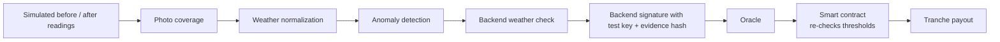
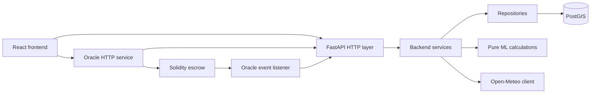

# CoolRoof Commons

**Existing cool roof programs pay on invoice. We pay on measured outcome.**

A results-based climate finance prototype. **The demo uses simulated before/after measurements and photos; no physical coating experiment was performed.** The intended system works as follows: a sponsor's money is locked in a smart contract and released only when a reflective roof coating is verified against weather-normalized temperature and photo-coverage checks, using backend-signed evidence with a test key. Satellite data supports targeting and a separate observational study; it is not a mandatory payout check.

---

## Track

**Climate Data & Environmental Monitoring.**

The track's stated challenge is that *environmental data is fragmented and difficult to verify*, and it calls for climate-data verification platforms, IoT environmental monitoring, and tools for research and insight. CoolRoof Commons sits exactly there: it ingests satellite surface-temperature and albedo data, simulated ground measurements and backend-signed evidence with a test key, and hourly weather, then runs them through a verification pipeline whose output a smart contract acts on. The novelty is that we do not stop at *showing* verified environmental data; we bind a financial decision to it. Verified climate data is the product, and the payment is what proves the data mattered.

---

## How this maps to the judging criteria

- **Climate impact:** reflective roofs are a cheap, proven urban-heat intervention; the bottleneck isn't the intervention, it's trusting that it happened. We target that bottleneck. See [Why this problem](#the-problem) and [Target users and adoption](#target-users-and-adoption).
- **Innovation:** most climate-and-blockchain prototypes stop at *showing* verified data. We bind a financial decision to it, with a contract that independently re-derives its own pass/fail decision instead of trusting the oracle's verdict; see [Why blockchain is necessary](#why-blockchain-is-necessary). We also ran a real satellite verification study, applied our own multiple-comparison correction, and used its negative result as a design justification rather than hiding it; see [Findings](#findings).
- **Technical execution:** a layered backend, a measurable weather-normalization effect in simulation (19.1 °C raw spread → 3.87 °C normalized), two complementary anomaly detectors, a contract with its own threshold checks, and a test suite across every layer; see [Why AI is necessary](#why-ai-is-necessary) and [Tech stack](#tech-stack).
- **Practical usefulness:** the verification layer is built on low-cost sensors and free satellite/weather data by design, because verification cost is results-based climate finance's known blocker. The mechanism generalizes beyond roofs; see [Target users and adoption](#target-users-and-adoption).
- **Presentation:** the video and this README separate what was measured, what was simulated, and what wasn't tested, on purpose, throughout.

---

## The problem

Climate money is paid for the activity, not for the outcome.

- **Louisville's Cool Roof program** pays **$1 per square foot**, disbursed after installation on receipt of a signed application. ([louisvilleky.gov](https://louisvilleky.gov/government/sustainability/incentives))
- **France's repair bonus (bonus réparation)** pays a **flat €10–45 per device**, applied against the invoice at a registered repairer. ([service-public.gouv.fr](https://www.service-public.gouv.fr/particuliers/actualites/A16129?lang=en))

In both, payment is tied to a document, not to a result. The payment trigger does not itself establish measured cooling. **Results-based climate finance** exists as a concept, where payment follows independently verified outcomes, but its well-documented bottleneck is that monitoring and verification costs can become prohibitive. ([Climate Policy Initiative](https://www.climatepolicyinitiative.org/publication/results-based-financing/), [GPRBA](https://www.gprba.org/who-we-are/results-based-financing))

We attack exactly that bottleneck: cheap, auditable, tamper-resistant verification that a smart contract can release funds against.

### Our goal

Two things, not one. First, to actually find out whether an overheating roof got measurably cooler after a specific intervention, not assume it did because a coating was applied. This is what the prototype does today, on simulated measurements. Second, to use what we learn from every verified intervention to get better at picking *which* roof to fund next, so a limited budget goes to the roofs that will cool the most, not just the roofs that look dark on a map. That second goal is not built yet: today's targeting is a fixed, hand-weighted score, and no verified outcome feeds back into it. Verification and targeting are meant to feed each other over time, with every measured outcome becoming a data point for the next funding decision; see the first item of the [roadmap](#roadmap--what-we-would-build-next).

### Why this problem

Urban heat motivates reflective-roof retrofits, but funding an installation does not establish its cooling outcome. But the money that could spread them is stuck paying for installation certificates. The sponsor cannot tell if their money did anything, and the building owner cannot tell if the coating is worth it. That shared uncertainty is why cheap, effective interventions do not scale. We picked it because the gap is not technological novelty, it is *trust in the result*, and that is a verification problem.

---

## Existing solutions and what they miss

| Approach | What it does | What it does not do |
| --- | --- | --- |
| **Rebate / incentive programs** (Louisville, NYC, LA cool-roof rebates) | Pay a fixed amount per area on proof of installation | Installation documentation does not itself establish a measured cooling outcome |
| **Repair / circular bonuses** (France's bonus réparation) | Pay a flat amount per verified action | Verify the action, not the lasting outcome |
| **Satellite heat-mapping tools** (Google Heat Resilience, albedo datasets) | Identify which roofs to target, at building level | Targeting only; they do not verify a specific intervention or release funds |
| **Results-based climate finance** (RBCF, carbon finance) | Pay after independent verification of outcomes | Verification is slow and expensive, the known bottleneck; no automated release |

**What we offer that they do not:** a prototype loop that normalizes simulated readings against weather, screens anomalies, estimates coverage from a simulated photo, produces backend-signed evidence with a test key, and applies staged escrow rules. Real sensor integration remains future work. Targeting, verification, and release in one auditable mechanism.

---

## How it works



Satellite albedo and temperature support roof prioritization. In the demo, simulated readings and photos pass through coverage analysis, weather normalization, anomaly checks and a backend weather decision. The backend hashes the evidence and signs it with a test key. The oracle submits only approved results, except for an explicit insufficient-data durability storm. Flagged or ordinary insufficient-data results return `not_submitted`, with no transaction and no payment attempt. The contract independently requires an approved status and cooling/coverage thresholds, or a separate force-majeure code with gusts above 20 m/s or rainfall above 50 mm. These weather values still come from the oracle; the contract does not fetch weather itself.

---

## Why AI is necessary

**The strongest number first.** The same simulated coating under **62 real Open-Meteo weather hours** has a raw delta range of **19.1 °C**, reduced to **3.87 °C** after normalization (about **4.9×**). Separately, the standard deviation falls from **4.07 °C to 1.26 °C** (about **3.2×**). These are simulation metrics, not field performance. Without this step, a cloudy-morning "before" and a sunny-afternoon "after" would let anyone fake a cooling result; the normalization model (ridge regression on ambient temperature, radiation, wind, hour, and albedo) removes the weather-driven part and keeps the roof-specific change.

**Anomaly detection runs in two layers that catch different things:**

| Method | Precision | Recall |
| --- | --- | --- |
| Rules | 1.00 | 0.79 |
| Isolation Forest | 0.93 | 0.14 |
| Both together | 0.99 | 0.89 |

Rules catch the named cheats, for example a replay of an old upload with new timestamps. The Isolation Forest catches combinations that are physically inconsistent and slip past the rules by staying just inside a threshold, for example a −30 °C cooling under bright sun that the weather cannot explain. The combined detector improves recall on this simulated evaluation; field robustness has not been established.

**What these numbers are, and are not.** None of them is typed in by hand: `scripts/metrics.py` recomputes them from fixed seeds, so every rerun gives the same values. But the inputs are ours. The anomaly test set is 200 simulated honest sessions plus 9 failure modes we designed and injected ourselves (20 each), so precision and recall describe how well the detectors catch the attacks we anticipated, not unknown real-world ones. The normalization model is trained on surface temperatures from our physical model and evaluated on that same model under real weather, so the 19.1 → 3.87 °C result shows the regression learns the physics it is given; it does not show the physics matches a real roof. Even here a residual bias remains: the true delta at standard conditions is −21.1 °C, the normalized mean −20.0 °C.

---

## Why blockchain is necessary

The honest test: if removing it changes nothing, it is decoration. It does not here.

- **Payment is staged over time.** 60% on quality, 30% on durability after 180 days, 10% force-majeure reserve. Project cooling and coverage terms are fixed. Durability requires a distinct measurement taken on or after quality payment + 180 days. Sponsor reclaim opens at the later of creation + 365 days and quality payment + 180 days + a protected 30-day claim window; without quality payment, the original 365-day rule applies.
- **The parties do not trust each other.** Sponsor, contractor, building owner, and an independent verifier; if the contractor also measures, there is a conflict of interest.
- **The contract does not trust the oracle blindly.** It re-checks the normalized delta and coverage against thresholds that were written at project creation and cannot be changed.
- **Within one contract, the same project id cannot be double-registered and a tranche cannot be paid twice.** Physical-roof identity and a cross-institution registry are not implemented; different ids or contracts can refer to the same roof.

---

## What we measured, simulated, and did not test

| Measured (real) | Simulated | Not tested |
| --- | --- | --- |
| Satellite surface temperature (Landsat 8/9, ECOSTRESS) | Before/after temperature time series (physical model fed real weather) | Targeting accuracy ("satellite is sufficient for targeting" is our claim) |
| Satellite albedo (Sentinel-2) | Post-coating albedo (assumed 0.75, weighted by coverage) | Emissivity effect on satellite retrieval |
| Hourly weather (Open-Meteo, real archive) | Backend-signed evidence with a test key | Real device authentication and winter heating penalty |
| Building geometry (OpenStreetMap) | | A physical coating experiment |

The roof snapshot contains **726 roofs: 723 measured + 3 simulated** (576 Athens, 150 London), not 726 coating experiments. Temperature data in the interface is labelled `measured`, `simulated`, or `third_party`, and the two are never silently compared; a mixed comparison is rejected with a `409 mixed_data_source` error.

---

## Findings

We ran a real satellite study, and its result is part of the argument, not hidden.

1. **This study did not establish satellite verification at roof level.** Across **8 observational cases**, roof-to-pixel area ratios span **0.016 to 0.915** (about **57×**). These are different city, roof-size and sensor groups, not a controlled 57× enlargement of the same roof. A 100 m Landsat pixel covers 10,000 m²; the average roof here is ~172 m², so neighbouring surfaces contribute ~98% of each measured value. The absence of a significant satellite signal motivates ground measurement; it does not prove that ground verification works. Satellite targeting accuracy also remains untested.
2. **One result looked significant, and does not survive correction.** London large roofs on Landsat showed raw p = 0.023. With 8 tests, the Bonferroni threshold is 0.05/8 = 0.00625, so it fails. We implemented the multiple-comparison correction ourselves (Bonferroni and Benjamini–Hochberg) and **do not present this as a finding.**
3. **The same data gives opposite conclusions under two framings.** A pure-irradiation accounting ranks London ahead of Athens; a demand-weighted accounting (heating vs cooling degree-hours) ranks Athens ahead. We state which we use (demand-weighted) and why, and keep the other visible as a caution.

---

## Known limitations and roadmap

We split these into two kinds: facts that will always be true no matter how much we build, and gaps we would close with more time. Confusing the two would be dishonest in both directions.

### Methodology notes (true by design, not something to "fix")

- Surface temperature is **not** air temperature, and is certainly not CO₂ reduction. We report them as separate metrics and always will.
- A reflective roof can **increase** winter heating load. This is a real physical trade-off, larger in colder climates, not a bug.
- Blockchain does not prove a measurement is true; it prevents the record from being altered afterwards. Truth is defended by what feeds the chain (signature, anomaly checks, thresholds), not by the chain itself: the backend and oracle are trusted to provide inputs. This is the oracle problem, and it is inherent to any system where real-world events are reported on-chain, not specific to our implementation.
- The satellite comparison is **observational**, not a controlled before/after experiment, because we compared different buildings in different places, not the same roof before and after treatment. The satellite study is not a required verification gate.
- "Satellite is sufficient for targeting" is our working assumption; this analysis tested satellite verification, not satellite targeting accuracy.

### Roadmap — what we would build next

- **A predictive targeting model.** Today a roof's priority is a fixed, hand-weighted score over its own static properties (surface temperature 0.45, low albedo 0.35, area 0.20). Nothing in it is learned, and no verified outcome flows back into it. The real question is which roof, if funded *today*, would deliver the best cooling outcome. We'd train a model on the record of verified interventions (the roof's own features, the weather it was measured under, and the normalized cooling actually measured) to predict expected cooling before a roof is funded. The backend already stores roof features, weather and each measurement's normalized delta side by side, so every completed, verified project could become a labelled training example; the training set and the model are not built. Three simulated demo roofs are nothing to train on, so this depends on the physical pilot below, and is the highest-value thing to build once real outcomes exist.
- **Real device-side signing.** Evidence is currently backend-signed with a test key, and the contract records the signature without authenticating a device. A production system needs signing on the measuring device against a registered-device key, with replay protection tied to device identity.
- **A physical pilot.** We did **not** run a physical coating experiment; the before/after series is simulated from a physical model fed real weather. The next step is a small number of real roofs with real sensors and real coating.
- **Calibrated thresholds.** Athens's −8.0 °C and London's −6.0 °C cooling thresholds are reasoned from summer-irradiation ratios, not calibrated against local field measurement. Post-coating albedo (0.75) is likewise an assumption pending real data.
- **Emissivity correction.** We did not test whether bright, low-emissivity roofing materials (e.g. metal roofs) bias the satellite surface-temperature retrieval; this is a known confound we'd want to rule out before trusting satellite data for anything beyond targeting.
- **A fresh Amoy deployment.** `docker-compose.amoy.yml` now supplies the Amoy override and frontend build arguments, but it needs a new deployment, RPC URL, deployment block and local keys, none of which are committed. The submission demo remains local. The recorded Amoy address reflects an earlier deployment: the current source adds payment and reclaim protections that are not installed there, so it should be redeployed and re-verified before being treated as authoritative.
- **Production-grade access control.** Local mode allows unconfigured API keys and binds published Docker ports to loopback. Outside local mode, separate operator and event API keys are mandatory, and Docker event ingestion independently checks the configured chain, escrow, successful receipt, canonical block and decoded event fields. Production operations still need TLS, key rotation and an appropriate access policy.
- **Weather provenance for force majeure.** The contract checks the submitted gust and rainfall values against its thresholds, but not where they came from; there is no external weather feed. The storm reserve may also be applied after quality payment, before the normal 180-day durability date.
- **Public-sector adoption path.** Most public bodies cannot lock a budget into a smart contract without jurisdiction-specific procurement review; the realistic first user is a private sponsor or foundation, with public-sector adoption as a later, policy-dependent step.
- **Cross-institution double-counting.** The contract prevents the same project id from being paid twice *within itself*; it does not yet prevent the same physical roof from being registered under a different id, in a different contract, or in a separate ESG report. A cross-institution roof registry would close this.
- **ForceMajeure values in the timeline.** Wind and rain values used in a force-majeure decision are on-chain but currently shown only as text in the backend event timeline, not as structured, queryable fields.

---

## What we learned

If the contract is not the single source of truth, tests verify the wrong thing. Our frontend was written against an invented schema and **38 tests passed** while it could not connect to the real backend at all. We closed the evidence schemas (`additionalProperties: false`) and added a contract test so a wrong field name now fails the build instead of silently becoming `unknown`.

Our satellite study did not find a corrected significant roof-level association. This motivates a ground-measurement experiment; it does not establish the accuracy of an untested ground system.

---

## Target users and adoption

- **Who:** a municipality, university, foundation, or corporate sponsor funding reflective-roof retrofits in a neighbourhood, plus the contractors who apply the coating and an independent verifier.
- **Adoption:** the verification layer is designed to be cheap, using low-cost sensors and open satellite and weather data, precisely because the known blocker for results-based finance is verification cost.
- **Scale:** the same measure → normalize → verify → release loop applies to tree planting, insulation, and water savings; the roof is simply our first case. Thresholds are per-city and derived from climate data, so the method travels to cities with no proprietary dataset (we fall back to OpenStreetMap and Sentinel-2 at block level).

---

## Live contract

Recorded earlier deployment on **Polygon Amoy testnet** (chain ID 80002); the address and transaction below are historical references, not verification of the updated source:

- [Contract: `0xe583D50083A892DAcb0932cCA2D90dfCb22d4788`](https://amoy.polygonscan.com/address/0xe583D50083A892DAcb0932cCA2D90dfCb22d4788)
- Example transaction (quality tranche released): [`0x62f1f167…`](https://amoy.polygonscan.com/tx/0x62f1f167f10b4744a7015da7670cd0be8643d2261a4fe70cdc7d47dc5d9a7375)

The three demo scenarios in the video run on a local Hardhat node for repeatability; the Amoy reference documents an earlier deployment. The interface shows a network badge (`LOCAL CHAIN · 31337` or `AMOY · 80002`) so the chain in use is always visible.

---

## Quick start

```bash
scripts/start.sh          # brings up db, backend, frontend, local chain, oracle; loads 726 roofs
scripts/demo-round.sh     # opens and funds a fresh demo round on the local chain
```

Then open:

| | |
| --- | --- |
| App (map) | http://localhost:5173 |
| Demo console | http://localhost:5173/demo |
| API docs | http://localhost:8000/docs |

Click the three scenarios on the demo console in order. **To repeat the demo**, run `scripts/demo-round.sh` again; each on-chain tranche pays only once, so a fresh round is needed. Do **not** run `scripts/reset.py` (it wipes all data); use the demo-round script. `POST /demo/reset` only opens a backend round; it does not fund that round on chain.


---

## Tech stack

| Layer | Choice |
| --- | --- |
| Backend | Python 3.11, FastAPI, layered architecture |
| Database | PostgreSQL 16 + PostGIS |
| ML | scikit-learn (ridge regression, Isolation Forest), OpenCV |
| Frontend | React 19 + Vite + TypeScript, Mantine, Leaflet |
| Contract | Solidity 0.8, Hardhat |
| Chain | Polygon Amoy testnet, ethers.js v6 |
| Data | Google Earth Engine access to Landsat 8/9 ST_B10, ECOSTRESS, Sentinel-2, OpenStreetMap, Open-Meteo |

## Sources

- [Louisville Cool Roof Incentive Program](https://louisvilleky.gov/government/sustainability/incentives)
- [France, bonus réparation (Service-Public.fr)](https://www.service-public.gouv.fr/particuliers/actualites/A16129?lang=en)
- [Climate Policy Initiative, Results-Based Financing](https://www.climatepolicyinitiative.org/publication/results-based-financing/)
- [GPRBA, Results-Based Financing](https://www.gprba.org/who-we-are/results-based-financing)
- [Google Earth Engine](https://earthengine.google.com/) — access to Landsat, ECOSTRESS and Sentinel-2. Albedo is derived from Sentinel-2 bands using Liang coefficients; the Google Heat Resilience dataset is not used.
- [OpenStreetMap](https://www.openstreetmap.org/) — building geometry
- [Open-Meteo](https://open-meteo.com/) — hourly weather

## Architecture



HTTP, state hooks, presentation and chain reads are separated in the frontend. Backend services orchestrate repositories and calculations; repositories own database queries and commits. The Open-Meteo HTTP adapter lives under `backend/app/infrastructure/clients/`. ML has no database or FastAPI dependency. Pure image calculations live in `ml/coverage.py`; image file I/O is in `backend/app/infrastructure/coverage_files.py`. Verification uses repository data records and repository-owned writes; other legacy services still use ORM objects. Decision thresholds are centralized in `schema/thresholds.json`.

## Running everything with Docker

One command starts the database, the backend (migrations and the demo seed run as it
starts), a local Hardhat chain with the escrow deployed and the three demo projects funded,
the oracle server and listener, and the frontend:

```bash
scripts/start.sh            # Git Bash on Windows, or any POSIX shell
```

It creates `.env` with a fresh backend evidence signing key on the first run, builds the images (a few
minutes the first time) and waits until every service is healthy. Then open:

| | |
| --- | --- |
| App | <http://localhost:5173> |
| Demo console | <http://localhost:5173/demo> |
| API docs | <http://localhost:8000/docs> |
| Oracle health | <http://localhost:4020/health> |

Earth Engine steps are skipped: the evidence pages use `data/snapshots/`, and a fresh database
imports all 726 snapshot roofs (723 measured and 3 simulated) plus the weather needed for the demo.
The seed restores the three simulated demo roofs (`ATH-0142`, `ATH-0287`, `ATH-0355`).

Each tranche pays once per project. To repeat the demo, open and fund a fresh round:

```bash
scripts/demo-round.sh
```

After opening a fresh round, `python scripts/verify_local_demo.py` checks all 726 roofs,
the three scenarios, and a frozen-sensor result whose cooling and coverage pass but
whose flagged status must cause no transaction or payment. This command uses seeded
measurements for the three scenarios and uploads an additional synthetic adversarial
measurement/photo. It changes local demo data and refuses any non-local chain.
Open another fresh round before presenting. This API/chain check is separate from the
browser UI and the fixture-based unit tests.

`docker compose down` stops everything; `docker compose down -v` also deletes the database.
Docker defaults to the local chain. For Amoy, deploy the updated contract, populate the required local variables and use `docker compose -f docker-compose.yml -f docker-compose.amoy.yml up -d --build --wait`. The override does not deploy or fund projects automatically. Set `ALLOW_MAINNET_SPEND=true` only when intentionally sending Amoy transactions. Use Operator access in the header to enter the operator key for this browser session.

## Running the pipeline

The pipeline turns OSM footprints, satellite imagery and Open-Meteo weather into the
database rows and the three reports the backend serves. Run every command from the
repository root, in this order. Times were measured on a laptop with warm caches unless
marked *approx.*

**If Earth Engine or the network is unavailable on demo day, skip the pipeline:** the
backend serves the committed copies in `data/snapshots/` whenever `data/` has no fresh
report (a warning is logged when it does).

### 0. One-time setup

```bash
docker compose up -d db                       # PostGIS only, on localhost:5432
python -m venv backend/.venv                  # Python 3.11
source backend/.venv/Scripts/activate         # PowerShell: backend\.venv\Scripts\Activate.ps1, macOS/Linux: source backend/.venv/bin/activate
pip install -r scripts/requirements.txt       # includes backend/ and ml/ requirements
cp backend/.env.example backend/.env          # then set DEVICE_PRIVATE_KEY and EE_PROJECT
cd backend && alembic upgrade head && cd ..   # create the tables
```

`pip install` takes about 3–5 min on a clean environment (*approx.*). The scripts read
`backend/.env` too, so `EE_PROJECT` belongs there.

### 1. Earth Engine authentication

```bash
earthengine authenticate
```

Opens a browser once and stores a token in your user profile. The Google Cloud project in
`EE_PROJECT` must be registered for Earth Engine with the API enabled. Only step 3 needs it.

### 2. Building footprints — `fetch_buildings.py`

```bash
python scripts/fetch_buildings.py --city athens --set small --source extract
python scripts/fetch_buildings.py --city athens --set large --source extract
python scripts/fetch_buildings.py --city london --set small --source extract
python scripts/fetch_buildings.py --city london --set large --source extract
```

Produces `data/buildings_<city>[_large].geojson` and upserts the roofs into `roofs`.
`--source extract` reads the Geofabrik extracts, which must be downloaded by hand first
(about 470 MB):
`data/cache/geofabrik/greece-latest.osm.pbf` and
`data/cache/geofabrik/greater-london-latest.osm.pbf` from <https://download.geofabrik.de>.
About 30 s per set with the extract. The default `--source overpass` needs no download
but the public server is slow and has timed out after 15 min, so prefer the extract.

### 3. Satellite metrics — `fetch_satellite.py`

```bash
python scripts/fetch_satellite.py --city athens --set small
python scripts/fetch_satellite.py --city athens --set large
python scripts/fetch_satellite.py --city london --set small
python scripts/fetch_satellite.py --city london --set large
```

Produces `data/satellite_metrics_<city>_<set>.csv` (Landsat and ECOSTRESS surface
temperature, Sentinel-2 albedo per roof) and updates the roofs' measured `albedo`,
`surface_temp_c` and `priority_score`. About 1–2 min per set (*approx.*, Earth Engine
queue dependent). The CSV is a cache: reruns reuse it unless `--refresh` is passed.

### 4. Weather — `fetch_weather.py`

```bash
python scripts/fetch_weather.py --city athens --start 2026-07-01 --end 2026-07-07
```

Upserts hourly Open-Meteo weather (`data_source = third_party`) into `weather_records`,
one request per roof, cached under `data/cache/open_meteo/`. This week is what verification
and `metrics.py` (roof `ATH-1000`) use. It covers every Athens roof in the table: 576
roofs x 168 h, about 97 000 rows (the current demo database holds it for the 303 small
roofs, 50 904 rows). For a quick run, `--roof-id ATH-1000` is enough for `metrics.py`.
Without `--start/--end` it fetches the whole summer, about 13x more rows. A few minutes
(*approx.*); the API needs no key.

### 5. Clean the large-roof sets — `clean_large_roofs.py`

```bash
python scripts/clean_large_roofs.py
```

Must run **before** `satellite_evidence.py`. Reads each large roof's OSM tags from the
Geofabrik extracts and writes `data/large_roof_exclusions.json` (stadiums, garages,
sports halls and parking are excluded). About 90 s, almost all of it reading the extracts.

### 6. Satellite evidence — `satellite_evidence.py`

```bash
python scripts/satellite_evidence.py
```

Reads the satellite CSVs and the exclusions and writes `data/satellite_evidence.json`
(8 dark-vs-bright cases with Bonferroni and FDR correction), served at
`GET /evidence/satellite`. About 3 s, offline.

### 7. Climate comparison — `climate_comparison.py`

```bash
python scripts/climate_comparison.py
```

Writes `data/climate_comparison.json` (Athens vs London seasonal energy balance,
`data_source = simulated`), served at `GET /evidence/climate-comparison`. About 2 s with
the Open-Meteo cache warm; the first run downloads summer and winter weather per city.

### 8. Method metrics — `metrics.py`

```bash
python scripts/metrics.py
```

Writes `data/metrics.json` (anomaly-detection precision/recall and normalisation
stability, `data_source = simulated`), served at `GET /metrics`. Needs the weather from
step 4. About 13 s.

### 8b. Threshold rationale — `threshold_rationale.py`

```bash
python scripts/threshold_rationale.py
```

Derives each city's cooling threshold from step 7: Athens's -8.0 °C scaled by the ratio of
summer irradiation (London 562 / Athens 695 kWh/m² = 0.81, so about -6.5 °C), rounded
toward zero to a whole degree (-6.0 °C). Writes `data/snapshots/threshold_rationale.json`
and warns when `schema/thresholds.json` no longer matches; a scripts test fails then too.
The one-sentence `rationale` per city in `schema/thresholds.json` is what the backend
returns and the roof page shows. Instant.

### 9. Demo scenarios — `seed.py`

```bash
python scripts/seed.py
```

Writes the three demo roofs (`ATH-0142`, `ATH-0287`, `ATH-0355`) with their
measurements, verifications, simulated weather and contract tranches. Only these roofs'
rows are replaced; real roofs and third-party weather are kept. A few seconds (*approx.*).

### Refreshing the snapshots

After a successful run, copy the three reports into `data/snapshots/` and commit them
(`data/` is git-ignored except for this folder):

```bash
cp data/satellite_evidence.json data/climate_comparison.json data/metrics.json data/snapshots/
git add data/snapshots/
```

### Resetting the database

`scripts/reset.py` deletes **every** row, including the satellite-measured roofs and the
real weather (steps 2–4 rebuild them), then runs the seed. It prints what it would delete
and refuses to run unless `--force` is passed and `RESET` is typed:

```bash
python scripts/reset.py --force
```

### Starting the backend

```bash
cd backend && uvicorn app.main:app --reload
```

## Follow-up validation and operations

- `cd frontend && npm run test:e2e` opens Chrome against the running local Docker stack. It uploads all three scenarios, checks the refused result has no explorer link, verifies the network badge and unfunded reset, then leaves a fresh funded local round. The test refuses public networks.
- `WRITE_API_KEY` protects measurement/photo uploads, demo reset and oracle submission. `EVENT_API_KEY` is separate and is only for the oracle event relay. Outside `APP_MODE=local`, missing keys fail closed. Export `WRITE_API_KEY` in the shell when running protected reset/validation scripts; never bake it into Vite build arguments.
- If local port 5432 is occupied, set `POSTGRES_HOST_PORT=15432` in the root `.env`. Internal Docker database traffic stays on 5432; host pipeline scripts need a matching `DATABASE_URL`.
- The local Hardhat calendar starts at February 2027 so simulated January 2027 storm timestamps are not future measurements. Public networks keep their real clock and do not inherit this demo setting.
- Coverage fallback is only for simulated records that never referenced a photo. A missing uploaded image cannot be promoted to full-confidence evidence.
- Weather summaries include precipitation and the exact available follow-up window. Oracle submission uses that same summary rather than a separate nearest-hour rainfall query.
- The contract ABI now includes a hashed measurement id and measured-at timestamp; prior deployments and clients must be replaced or updated together.
